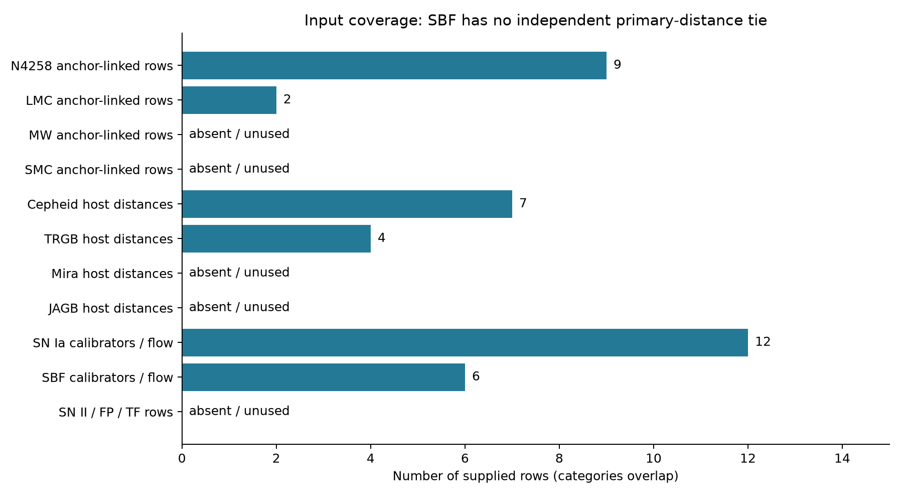
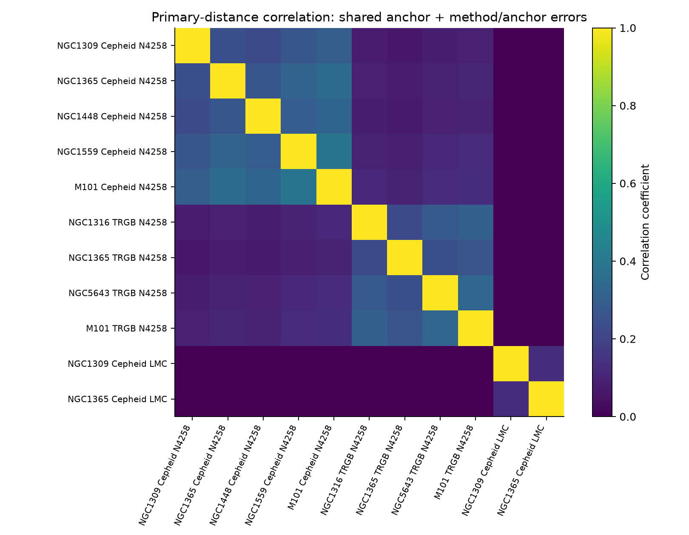
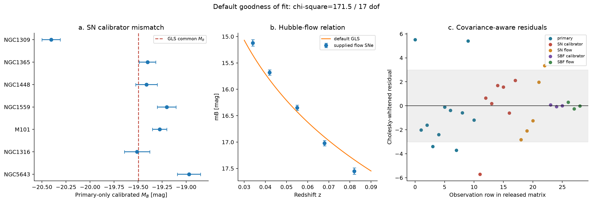
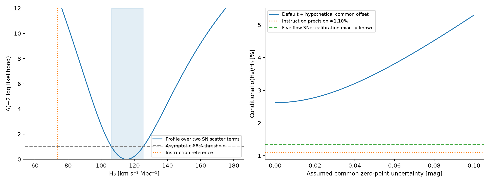
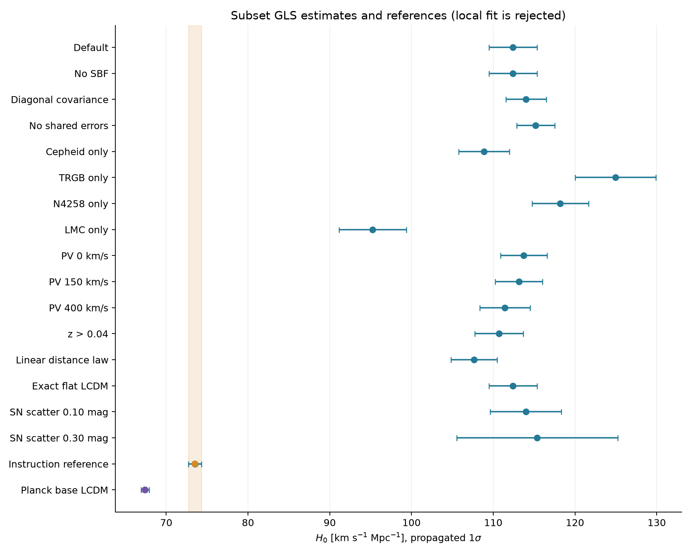
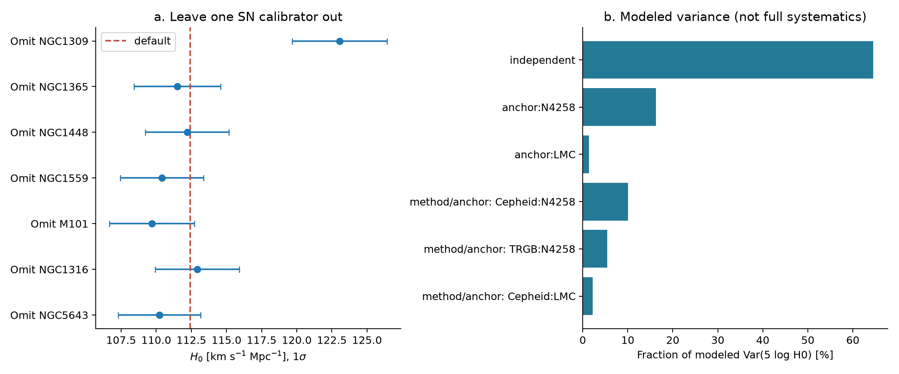

# A covariance-weighted distance-network analysis of the supplied minimal dataset

## Abstract

A joint generalized least-squares (GLS) fit to the supplied primary-distance, supernova and Hubble-flow observations yields **H₀ = 112.41 ± 2.95 km s⁻¹ Mpc⁻¹**, with **2.62% propagated precision**. The transformed 68.27% interval is [109.50, 115.39] km s⁻¹ Mpc⁻¹. This numerical estimate fails a common-population goodness-of-fit test: χ² = 171.53 for 17 degrees of freedom, p = 1.39e-27. It therefore does not establish a robust cosmological measurement. The instruction reference, 73.50 ± 0.81 km s⁻¹ Mpc⁻¹ (1.10%), is not reproduced. Independent numerical formulations agree, while the SN calibrators imply mutually inconsistent absolute magnitudes under the stated errors. Several requested indicators are absent, and the supplied SBF branch lacks an independent absolute-distance calibration. We report the executed subset inference, its full feasible sensitivity matrix and numerical validation, and distinguish these from the unresolved full-network objective and the release status below.

## 1. Scientific question and provenance

The task asks whether a covariance-weighted network of geometric anchors, primary indicators, secondary calibrations and Hubble-flow observations can provide an approximately 1% consensus H₀ and a defensible comparison to CMB inference. The experiment here uses every numerical observation in `data/H0DN_MinimalDataset.txt` without changing it or importing external measurements. The quoted task baseline is a comparison value, never a likelihood term, prior or tuning target. All reported local numbers are generated by `code/analyze_network.py` and `code/repair_consensus.py` and trace to `outputs/headline_results.json`, `outputs/variants.csv` and the released local matrices.

Public grounding used the configured bundled retriever with three complementary initial queries and one focused followup for GLS methodology, Planck cosmology and SBF calibration. The local literature, arXiv and OpenAlex were included; the other enabled providers were handled by the profile. Fourteen of fifteen recorded attempts succeeded; one Semantic Scholar request returned HTTP 429. Query-level records are in `outputs/retrieval_query_plan.json` and `outputs/retrieval_trace.json`. Two full texts were inspected: the supplied Riess paper and public Blakeslee HTML. The Planck numerical comparison uses its public abstract. Excluded material was not used, and no hidden-source identity was sought. The followup examined public covariance/software availability. The [public SH0ES/Pantheon+ documentation](https://pantheonplussh0es.github.io/) and cached Riess text (§5, Figure 16) describe standardized SN and host-distance covariance products for their own dataset. They do not establish a complete covariance, standardization mapping, or every missing indicator for this supplied minimal file. Importing unrelated measurements cannot repair its absent links. No additional paper full text was acquired. These compatible sources guide methodology without imposing a reproduction of their datasets.

## 2. Data overview and absolute calibration

| Component | Supplied content | Scientific role and limitation |
| --- | --- | --- |
| Geometric references | NGC4258: μ=29.397±0.032 mag; LMC: 18.477±0.024 mag | Nominal anchor calibrations underlying host moduli; no raw maser or eclipsing-binary likelihoods |
| MW | μ=0, error=0 placeholder | No parallax observations and no MW-linked host row; supplies no weight |
| SMC | Absent | Cannot test or combine this anchor |
| Cepheids | 7 distance rows in 5 hosts | Five N4258-based rows and two LMC-based rows |
| TRGB | 4 rows in 4 hosts | N4258-based; two hosts overlap Cepheids |
| Miras, JAGB | Absent | No additional primary pathways |
| SNe Ia | 7 calibrator hosts and 5 flow SNe, z=0.034–0.082 | Only supplied branch with an independent anchor-to-Hubble-flow calibration |
| SBF | 3 calibrator galaxies and 3 flow galaxies, z=0.023–0.045 | Fornax/Virgo group labels supplied only for SBF hosts; group means lack primary-distance ties |
| SNe II, FP, TF | Absent | Cannot contribute to this consensus |
| Shared error terms | Method/anchor errors 0.03–0.05 mag for observed pairs; group depth 0.10 mag | Covariance model described below; unused MW error term has no data to act on |

There are 11 primary-distance rows in seven distinct hosts. The default likelihood has 29 observations and 12 parameters: seven host moduli, SN absolute magnitude M_B, h=5 log₁₀H₀, SBF absolute magnitude, and two SBF group moduli. NGC1365 and M101 provide overlap between Cepheids and TRGB. Primary rows are already absolute distance moduli; adding 29.397 or 18.477 to them would incorrectly apply calibration twice. The nominal anchor values identify the reference scale; their uncertainties propagate as shared shifts around that scale.

*Figure 1. Counts of supplied observations and unused or absent input pathways. Anchor, primary and secondary categories overlap and must not be summed. SN Ia includes seven calibration plus five flow rows; SBF includes three plus three. SBF presence alone does not imply an independently calibrated branch.*

In the SBF branch, calibration magnitudes constrain μ_group + M_SBF, while flow observations constrain M_SBF − h. In isolation the four parameters (h, M_SBF, μ_Fornax, μ_Virgo) have rank three and exact null vector (1,1,−1,−1). The joint network has full rank because SNe Ia fix h, after which SBF flow fixes M_SBF and calibrator magnitudes determine group distances. This is a calibration of SBF *from* the SN scale; SBF does not independently improve that scale. Omitting SBF changes H₀ by only 8.0e-12 km s⁻¹ Mpc⁻¹, numerical roundoff. No unlisted group membership is assumed for NGC1316, NGC1365 or other primary hosts. The relevance of independent primary-to-SBF ties is supported by the Cepheid and TRGB calibration approach in [Blakeslee et al. (2021)](https://arxiv.org/abs/2101.02221).

## 3. Likelihood and covariance construction

For primary observation i of host g, yᵢ=μ_g+εᵢ. For a calibrating SN, m_B=μ_g+M_B+ε. For a flow SN,

\[
m_B=M_B+F(z)-h+\epsilon,\qquad h=5\log_{10}H_0,
\]

\[
F(z)=5\log_{10}\left[c z\left(1+\frac{1-q_0}{2}z-\frac{1-q_0-3q_0^2+j_0}{6}z^2\right)\right]+25.
\]

Here c=299792.458 km s⁻¹, q₀=−0.55 and j₀=1; the luminosity distance is in Mpc after division by H₀. SBF uses the analogous magnitude equations, with group distances free. We interpret the supplied mB values as standardized magnitudes, since light curves, colors and standardization corrections are absent. This assumption is consequential and cannot be confirmed from the file.

Write the model as y=Xθ+ε. The default primary covariance is

\[
C_{ij}=\delta_{ij}s_i^2+\mathbf1_{a_i=a_j}\sigma_{a_i}^2
 +\mathbf1_{(m_i,a_i)=(m_j,a_j)}\sigma_{m_i,a_i}^2.
\]

For example, N4258 uncertainty is shared between Cepheid and TRGB rows, whereas the Cepheid/N4258 method term is shared only within that pair. LMC has its own independent anchor and method shifts. Individual errors are interpreted as excluding these explicitly additional calibration terms. The file does not define all cross-method or photometric dependencies, so this is a transparent covariance reconstruction rather than a recovered complete published covariance.

For flow magnitudes, the diagonal variance is s_m² + [F′(z) σ_v/c]², with default σ_v=250 km s⁻¹, including the derivative of the cosmographic term. We use σ_z=σ_v/c and assume independent peculiar velocities; no coherent velocity covariance or redshift-frame metadata is supplied. SBF calibrator errors include independent 0.10-mag depth scatter about each shared free group mean. Group depth does not specify a mean distance or a mean-distance prior. Cross-covariances not supplied are zero in the reconstruction.

We whiten with a Cholesky factor C=LLᵀ, solve least squares for L⁻¹X and L⁻¹y, and compute

\[
\widehat\theta=(X^TC^{-1}X)^{-1}X^TC^{-1}y,\quad
V_\theta=(X^TC^{-1}X)^{-1},\quad
\chi^2=(y-X\widehat\theta)^TC^{-1}(y-X\widehat\theta).
\]

This joint magnitude-space approach and the cosmographic intercept are compatible with [Riess et al. (2022), equations 4–6 and their GLS solution](https://arxiv.org/abs/2112.04510). Their larger Cepheid/SN study is methodological context; its measurements are not added here. Gaussian h errors are transformed to H₀=10^(h/5). The symmetric σ_H₀=(ln10/5)H₀σ_h is a first-order propagated uncertainty; exact transformed 68.27% endpoints are also released. No χ² rescaling is applied to the default covariance.

*Figure 2. Primary-distance correlation matrix used in the default fit. Off-diagonal structure is induced by shared anchor and method/anchor shifts. Axes specify host, primary method and anchor. This is a model constructed from the supplied error terms, rather than a full empirical covariance release.*

## 4. Default estimate, uncertainty and consistency

The fit gives h=10.253970±0.056930 mag and M_B=-19.4950±0.0490 mag. The resulting H₀=112.41±2.95 km s⁻¹ Mpc⁻¹ has 2.62% formal precision. Both its precision and fit quality fail to support the requested approximately 1% robust consensus. Imposing the instruction H₀ value while profiling all other parameters gives χ²=434.12, so the reference cannot be obtained as a comparably good fit under this likelihood.

The modeled variance separates as follows; h is in magnitude units. For linear estimator h=wᵀy, each component contributes wᵀC_k w. These percentages partition the **modeled variance**, not an exhaustive physical systematic budget.

| Represented contribution | Fraction of modeled Var(h) [%] |
| --- | --- |
| Independent measurements + peculiar velocities | 64.54 |
| anchor:N4258 | 16.29 |
| anchor:LMC | 1.41 |
| method:Cepheid:N4258 | 10.08 |
| method:TRGB:N4258 | 5.47 |
| method:Cepheid:LMC | 2.21 |

The independent component further separates into:

| Independent contribution | Fraction of total modeled Var(h) [%] |
| --- | --- |
| primary | 25.20 |
| SN calibrator | 13.50 |
| SN flow | 25.84 |
| SBF calibrator | 0.00 |
| SBF flow | 0.00 |

Missing systematic inputs include SN light-curve standardization, selection effects, photometric zero-point correlations beyond the listed offsets, metallicity/extinction/crowding dependence, coherent flows and redshift-frame transformations, SBF stellar-population/color corrections, and uncertainties for absent indicator pathways. The file cannot quantify these terms. Adding arbitrarily chosen errors would not establish a total uncertainty. Merely inflating all errors by √(χ²/dof) would give σ_H₀≈9.36 km s⁻¹ Mpc⁻¹; that diagnostic does not repair calibration physics or justify a new consensus.

Independent primary-only host estimates yield the following calibrator magnitudes. These are obtained using the primary-row GLS likelihood, before allowing SN observations to move host distances. The uncertainties include correlated primary calibration and the supplied SN magnitude error.

| SN host | Primary-only μ [mag] | mB − μ [mag] | Marginal σ [mag] |
| --- | --- | --- | --- |
| NGC1309 | 32.505 | -20.405 | 0.095 |
| NGC1365 | 31.332 | -19.402 | 0.086 |
| NGC1448 | 31.313 | -19.413 | 0.112 |
| NGC1559 | 31.423 | -19.203 | 0.097 |
| M101 | 29.126 | -19.276 | 0.075 |
| NGC1316 | 31.391 | -19.511 | 0.133 |
| NGC5643 | 30.531 | -18.971 | 0.120 |

Their absolute magnitudes span 1.43 mag. In particular, NGC1309 is about 1 mag brighter than several other calibrated SNe. No supplied information establishes whether these numbers represent unstandardized supernovae, an illustrative dataset, or another omitted correction; assigning a cause would be speculative. A common standardized absolute magnitude with the quoted errors is rejected. The joint fit responds by moving some primary host distances substantially, which explains the large primary residuals despite close agreement between duplicate primary rows.

*Figure 3. (a) Independently primary-calibrated SN absolute magnitudes with marginal errors, and the joint fitted common M_B (dashed). Individual points share covariance; their bars are not independent discrepancy significances. (b) Supplied Hubble-flow SN apparent magnitudes and the default fitted relation; plotted bars show the supplied photometric errors, while the fit also includes peculiar-velocity uncertainty. (c) Cholesky-whitened residuals in released observation order, colored by data block. The shaded ±3 band is a diagnostic; fitted residuals have leverage-dependent variances, so it is not a per-point significance threshold. The squared whitened residuals sum to the reported χ².*

### 4.1 Evidence repair: estimated scatter and precision limits

The new computation in `code/repair_consensus.py` fits two nonnegative independent SN scatter terms, one for calibrating SNe and one for flow SNe, while preserving every observation, shared calibration covariance and free SBF group distance. For each scatter pair, the linear distance-network parameters are solved by GLS. Maximum likelihood minimizes χ² + log det C; restricted maximum likelihood (REML) adds log det(XᵀC⁻¹X) to account for the fitted linear parameters. These are alternative variance models, not recovered standardization corrections or independent measurements.

| Inferred-scatter model | H₀ [km s⁻¹ Mpc⁻¹] | Conditional σ(H₀) | Calibrator scatter [mag] | Flow scatter [mag] |
| --- | --- | --- | --- | --- |
| Maximum likelihood | 115.32 | 9.35 | 0.402 | 0.147 |
| REML | 115.40 | 10.29 | 0.445 | 0.169 |

Profiling the maximum likelihood over both scatter terms and all other distance-network parameters gives H₀ = 115.32, with a likelihood-ratio interval **[106.16, 125.34] km s⁻¹ Mpc⁻¹** at Δ(−2 log L)=1. Its half-width is 8.32% of the estimate. This uses an asymptotic 68.27% convention; coverage is not established for this small sample. The conditional errors in the table hold estimated scatters fixed. No ordinary χ² goodness-of-fit p value is assigned after fitting these variance terms. The scatter extension absorbs discrepancies at substantially lower precision and cannot establish the full requested consensus.

An optimistic precision bound is available without fitting any new data. If the SN absolute magnitude were known exactly, the five flow SNe would give σ_h = [Σᵢ 1/vᵢ]⁻¹ᐟ². Their fractional H₀ uncertainty would still be **1.333%** with supplied 250 km s⁻¹ velocity uncertainty, or 1.099% with velocities known exactly. Calibration uncertainty and fitted intrinsic scatter increase these bounds. This bound concerns the supplied calibrated SN pathway; it does not constrain a future network with new independent observations.

A further sensitivity calculation adds a hypothetical common primary zero-point uncertainty τ. It verifies numerically that Var(h) increases by exactly τ²: the shared shift is indistinguishable from the network absolute scale. The grid τ=0–0.10 mag is an explicit assumption scan, not an empirical systematic budget. The data cannot identify its magnitude, and neither fitted independent scatter nor a zero-assumed cross-covariance measures it. Missing MW parallaxes, SMC, Miras, JAGB, SNe II, FP, TF, independent SBF primary ties and standardization/covariance products remain absent.

*Figure 6. Left: likelihood profile after reoptimizing calibrator and flow SN scatter and all remaining parameters at each H₀, with the Δ(−2 log L)=1 interval and instruction reference. Right: conditional precision versus an assumed common primary zero-point uncertainty; the horizontal green line is the optimistic bound for the supplied five flow SNe with an exactly known SN absolute magnitude. The blue curve uses the original default model, while the left panel uses estimated scatter; they are distinct diagnostics. The assumed systematic scan does not supply missing physical uncertainties. Numerical values and curves are in `outputs/consensus_repair.json`, `outputs/scatter_profile.csv` and `outputs/systematic_sensitivity.csv`.*

## 5. Analysis variants and influence

All feasible declared comparisons are executed below. Geometric/indicator subsets retain only the SN calibrators with a retained primary host measurement, while retaining the same five flow SNe and SBF block unless stated. Consequently their data coverage differs; the changes cannot be interpreted as pure anchor zero-point differences. SBF adds six rows and three parameters to the SN/primary fit. “Diagonal covariance” retains the full marginal variance of each row but discards off-diagonal terms. “No shared errors” removes anchor and method contributions entirely, testing the alternative interpretation that individual errors already contain calibration uncertainty. Both simplifications understate dependence under the default interpretation.

| Analysis | H₀ ± σ [km s⁻¹ Mpc⁻¹] | σ/H₀ [%] | χ² / dof | N primary / SN calib / SN flow |
| --- | --- | --- | --- | --- |
| Default | 112.41 ± 2.95 | 2.62 | 171.53 / 17 | 11 / 7 / 5 |
| No SBF | 112.41 ± 2.95 | 2.62 | 171.37 / 14 | 11 / 7 / 5 |
| Diagonal covariance | 114.02 ± 2.47 | 2.17 | 157.62 / 17 | 11 / 7 / 5 |
| No shared errors | 115.20 ± 2.33 | 2.02 | 180.27 / 17 | 11 / 7 / 5 |
| Cepheid only | 108.87 ± 3.09 | 2.84 | 150.81 / 13 | 7 / 5 / 5 |
| TRGB only | 124.96 ± 4.94 | 3.95 | 41.55 / 10 | 4 / 4 / 5 |
| N4258 only | 118.19 ± 3.45 | 2.92 | 132.34 / 15 | 9 / 7 / 5 |
| LMC only | 95.24 ± 4.12 | 4.32 | 67.21 / 8 | 2 / 2 / 5 |
| PV 0 km/s | 113.73 ± 2.86 | 2.51 | 184.11 / 17 | 11 / 7 / 5 |
| PV 150 km/s | 113.13 ± 2.89 | 2.55 | 178.35 / 17 | 11 / 7 / 5 |
| PV 400 km/s | 111.42 ± 3.08 | 2.77 | 162.64 / 17 | 11 / 7 / 5 |
| z > 0.04 | 110.70 ± 2.96 | 2.67 | 162.45 / 16 | 11 / 7 / 4 |
| Linear distance law | 107.66 ± 2.81 | 2.61 | 182.26 / 17 | 11 / 7 / 5 |
| Exact flat LCDM | 112.41 ± 2.95 | 2.62 | 171.53 / 17 | 11 / 7 / 5 |
| SN scatter 0.10 mag | 113.98 ± 4.34 | 3.81 | 74.78 / 17 | 11 / 7 / 5 |
| SN scatter 0.30 mag | 115.37 ± 9.85 | 8.54 | 14.12 / 17 | 11 / 7 / 5 |

The z>0.04 cut removes the lowest-redshift SN flow point. The velocity variants replace σ_v for both flow branches. “Linear distance law” uses d_L=cz/H₀; “Exact flat LCDM” integrates a flat Ω_m=0.3 luminosity distance, matching the default local q₀ and j₀. The two additional-scatter variants add the listed independent scatter in quadrature to every calibrator and flow **SN Ia** magnitude, with other terms unchanged. These are fixed sensitivity tests, not measured astrophysical scatter or optimized solutions.

*Figure 4. Default, complete feasible variant set, and independent reference values in km s⁻¹ Mpc⁻¹ with propagated 1σ bars. The orange band is the instruction reference ±0.81. Estimates share observations and calibration uncertainty and must not be averaged as independent measurements. None demonstrates the requested full-network precision.*

The extreme subset estimates range from 95.24±4.12 (LMC-only) to 124.96±4.94 (TRGB-only). The exact luminosity-distance integration changes the default by only 0.00035 km s⁻¹ Mpc⁻¹; cosmographic truncation does not explain the discrepancy. Adding 0.30-mag SN scatter gives 115.37±9.85 km s⁻¹ Mpc⁻¹ and χ²/dof=14.12/17, indicating that substantial additional variance can absorb the mismatch at much lower precision. This remains an assumed error model, not validation of the input calibration or a 1% result.

Leave-one-calibrator-out fits retain all primary observations and omit only the named SN calibration row:

| Omitted SN calibrator | H₀ ± σ [km s⁻¹ Mpc⁻¹] | χ² / dof |
| --- | --- | --- |
| NGC1309 | 123.04 ± 3.37 | 45.41 / 16 |
| NGC1365 | 111.50 ± 3.07 | 170.61 / 16 |
| NGC1448 | 112.20 ± 2.99 | 171.36 / 16 |
| NGC1559 | 110.40 ± 2.96 | 161.19 / 16 |
| M101 | 109.70 ± 3.02 | 163.18 / 16 |
| NGC1316 | 112.92 ± 3.00 | 170.29 / 16 |
| NGC5643 | 110.22 ± 2.94 | 153.93 / 16 |

Removing NGC1309 produces the largest shift, +10.63 km s⁻¹ Mpc⁻¹, but χ²/dof remains 45.41/16 (p=1.20×10⁻⁴). Outlier deletion alone does not establish a valid consensus. No observation is removed from the default result.

*Figure 5. (a) Leave-one-SN-calibrator-out estimates and their propagated 1σ errors; dashed line is the unchanged-data default. (b) Contributions to the default variance of h=5log₁₀H₀, including only uncertainty terms supplied or explicitly modeled. The independent contribution includes primary, SN calibration and flow errors.*

## 6. Numerical and scientific validation

The default covariance is positive definite (minimum eigenvalue 0.0016 mag²), and the 29×12 whitened design has rank 12 with condition number 15.69. Numerical identifiability does not establish physical completeness. The following checks were made after the unexpected result:

- A separate normal-equation solver agrees with the Cholesky solution to 2.84e-13 in the largest parameter difference.
- An analytic two-stage calculation first estimates host moduli from primaries, then M_B using the full host covariance plus SN errors, and independently estimates the flow intercept M_B−h. Its h differs by -1.55e-13 mag; the σ_h difference is -1.39e-17 mag.
- Replacing shared covariance terms by explicit Gaussian anchor and method-offset nuisance parameters reproduces the solution to 6.75e-14 in the largest parameter difference. This checks that common calibration errors were not counted as independent observations.
- With 50,000 Gaussian noise realizations, seed 20261106, the empirical σ_h is 0.056814 mag versus analytic 0.056930 mag, a ratio of 0.9980. This checks linear error propagation under the assumed covariance; it cannot validate the data-generating model.
- Units, magnitude signs, logarithm base, anchor calibration convention and the conversion between h and H₀ were checked explicitly. There is no initialization dependence in the linear GLS solution, no training/test split, and no normalization or plotting transformation used to force a reference match. Exact luminosity-distance integration confirms the default expansion approximation.
- The SBF-only null vector and equality of fits with/without SBF confirm the missing absolute calibration link. Calibration-magnitude, Hubble-diagram and covariance-aware residual plots support the poor-fit diagnosis.

These checks support the correctness of the **conditional computation** and the conclusion that this input and error model do not support the claimed cosmological precision. They do not turn the fitted 112.41 value into a physically credible measurement. Detailed records and decompositions are in `outputs/validation.json`; matrices and residuals are independently inspectable in `outputs/network_matrices.npz` and `outputs/residuals.csv`.

## 7. CMB comparison and interpretation

For context, [Planck 2018 VI](https://arxiv.org/abs/1807.06209) reports H₀=67.4±0.5 km s⁻¹ Mpc⁻¹ at 68% confidence under a spatially flat six-parameter ΛCDM model using the combined CMB constraints. This is a model-dependent inference, rather than a local geometric H₀ measurement. Assuming independent approximately Gaussian errors, the descriptive difference statistic is

\[
T=\frac{H_{0,\mathrm{local}}-H_{0,\mathrm{CMB}}}{\sqrt{\sigma_{\mathrm{local}}^2+\sigma_{\mathrm{CMB}}^2}}.
\]

| Local value being compared | Difference from Planck [km s⁻¹ Mpc⁻¹] | Gaussian difference statistic | Evidential status |
| --- | --- | --- | --- |
| Computed default 112.41±2.95 | 45.01 | 15.06 | Formal arithmetic from a rejected local model; not a cosmological tension significance |
| Instruction reference 73.50±0.81 | 6.10 | 6.41 | Context using the stated reference; not reproduced from this file |

The CMB dataset is not reused in the local likelihood, so no data-overlap covariance is introduced here. Shared background assumptions and the inadequacy of the local standardization/error model remain limits of this simple statistic. Local variants also share data with each other; their apparent differences are not independent tensions. There is no evidential basis here for claiming new physics, resolving the Hubble tension, or strengthening its significance. These arithmetic comparisons are recorded separately in `outputs/cmb_comparison.json`.

## 8. Reproducibility and release status

Run `/opt/anaconda3/envs/rcb-pilot/bin/python code/analyze_network.py` from the workspace. NumPy, SciPy, pandas and Matplotlib are the only scientific dependencies. Exact versions, input SHA-256 and result checksums appear in `outputs/reproduction_manifest.json`; `code/README.md` documents parameter conventions and each product. The script parses literal input assignments safely and preserves the supplied data and literature. Repeated default executions reproduced the pilot value; all subsequent figures are derived from the same final variant tables and matrix products.

The local deliverables include software, the original supplied input in the reproduction archive, derived likelihood matrices with parameter and row metadata, 16 analysis variants, seven omission fits, calibration diagnostics, residuals, error-propagation checks, query provenance, and six embedded PNG figures, including inferred-scatter likelihood profiles and precision limits. `outputs/local_reproduction_bundle.zip` packages the scientific software, input and derived products for transfer. **These are local products; no verifiable public release destination is available and no upload was performed.** The explicit public software/data release requirement therefore remains open.

## 9. Conclusions

**The default GLS estimate from the supplied identifiable network is H₀ = 112.41 ± 2.95 km s⁻¹ Mpc⁻¹ (68% propagated uncertainty; 2.62% precision; exact transformed interval 109.50–115.39).** The baseline fit has χ²/dof=171.53/17 and is strongly rejected. The 73.50±0.81 km s⁻¹ Mpc⁻¹ instruction baseline is not recovered, and approximately 1% total precision is not demonstrated.

Covariance-aware inference, identifiable-subset calibration, all feasible planned variants, error propagation and CMB reference arithmetic are executed and reproducible. Missing MW/SMC and indicator observations, missing independent SBF links, uncertain SN standardization and incomplete systematic information prevent completion of the full requested scientific consensus. The public-release requirement is also unresolved. The inferred-scatter likelihood profile gives 115.32 [106.16, 125.34] km s⁻¹ Mpc⁻¹, further excluding a supported 1% precision claim from the supplied observations. A faithful continuation requires the missing observations and covariance/standardization products, independent SBF primary ties, and a public release destination; a fitted reference prior, invented data or selective outlier deletion would not close those gaps.

Scientific validity of the documented calculation and negative feasibility conclusion, completion of the requested full-network measurement, and source-protocol reproduction are assessed separately in `outputs/report_rubric_check.json`. Structural validation is performed after this scientific and visual review and does not certify the science.

## References

1. [Riess et al. (2022), A Comprehensive Measurement of the Local Value of the Hubble Constant with 1 km/s/Mpc Uncertainty](https://arxiv.org/abs/2112.04510). Compatible GLS and cosmographic-intercept methodology; supplied `related_work/paper_000.pdf`, readable text in `artifacts/literature/riess2022.txt`.
2. [Blakeslee et al. (2021), The Hubble Constant from Infrared Surface Brightness Fluctuation Distances](https://arxiv.org/abs/2101.02221). Primary ties for absolute SBF calibration; full public text cached in `artifacts/literature/sbf2021.html` and `.txt`.
3. [Planck Collaboration (2020), Planck 2018 results. VI. Cosmological parameters](https://arxiv.org/abs/1807.06209). Public abstract supplies the base-ΛCDM CMB benchmark and its uncertainty.
